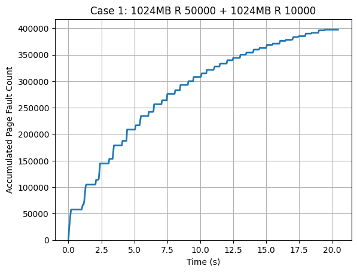
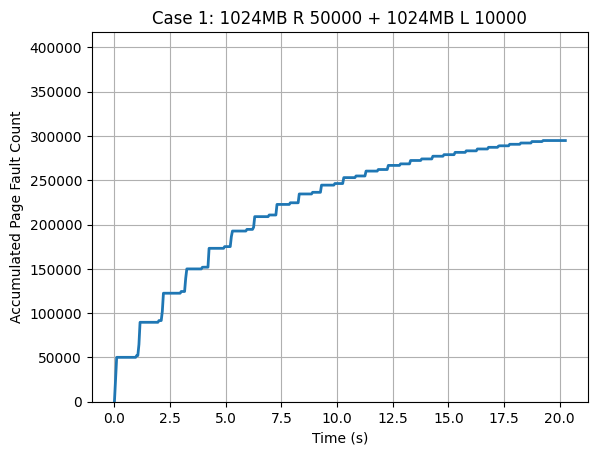
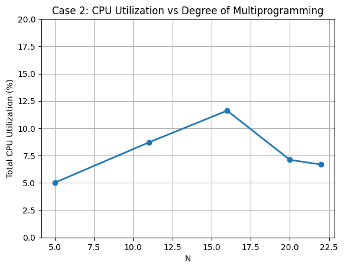

# MP3: Virtual Memory Page Fault Profiler

## Overview

In this MP, I implemented a Linux kernel module that profiles page fault activity and CPU utilization for registered user processes. The profiler exposes a `/proc/mp3/status` interface for process registration and deregistration, periodically samples the registered tasks in the kernel, stores the sampled data in a shared kernel buffer, and exposes that buffer to user space through a character device and `mmap()`.

The module samples at 20 Hz. Each raw sample is stored as four `unsigned long` values:
1. `jiffies`
2. `soft_faults`
3. `hard_faults`
4. CPU time in jiffies (`utime + stime`, converted from the raw kernel values before storage)

The sampling buffer is allocated with `vmalloc()` so it is virtually contiguous, initialized to `-1`, and later mapped into user space through the character device using `vmalloc_to_pfn()` and `remap_pfn_range()`. 

## Implementation Summary

### 1. Proc filesystem interface

The module creates `/proc/mp3/status`. Writing `R <PID>` registers a process for profiling, writing `U <PID>` unregisters it, and reading the file returns the list of currently registered PIDs. I used a linked list of small PCB nodes that stores the registered PIDs, and I protected that list with a mutex.

### 2. Registration and unregistration

On registration, the module checks that the PID is valid and not already present in the list, allocates a list node, and inserts it into the registered-task list. On unregistration, it removes the matching node and frees it. If registration makes the list transition from empty to non-empty, the sampling worker is started. If unregistration makes the list become empty, the sampling worker is stopped. This follows the MP requirement that the workqueue should start with the first registered task and stop when the list becomes empty.

### 3. Sampling workqueue

The module uses a delayed workqueue that executes every 50 ms (20 Hz). In each invocation, it iterates over all registered tasks, calls `get_cpu_use()` for each PID, and aggregates:
- soft faults
- hard faults
- CPU time in jiffies (`utime + stime`, converted to jiffies before storage)

It then writes one aggregate sample into the profiler buffer. The raw sample format used by my implementation is:
`(jiffies, soft_faults, hard_faults, cpu_time_in_jiffies)`.

### 4. Shared profiler buffer

The profiler buffer is allocated in module initialization with `vmalloc()` and freed in module exit. The buffer pages are marked reserved and the buffer is initialized to `-1`, which is the value expected by the provided monitor program. I store samples sequentially in the buffer up to the configured limit.

### 5. Character device and mmap

The module registers a character device with major number `423` and minor number `0`. The device file `node` is created with `mknod node c 423 0`. The `open()` and `release()` handlers are empty, and the `mmap()` handler maps the buffer pages into the requesting process’s virtual address space using `vmalloc_to_pfn()` and `remap_pfn_range()`. This allows the user-space monitor to read the profiled data without repeated copying between kernel and user space.

### 6. Why a mapped buffer is used

The MP motivation is that frequent user-kernel copies would add too much overhead for fine-grained sampling. Using a shared mapped buffer allows the monitor to read the sampled data directly from memory, which keeps the profiler lightweight and makes the measurements more faithful. 

---

## Case Study 1: Thrashing and Locality

### Workloads

#### Experiment 1
```bash
nice ./work 1024 R 50000 &
nice ./work 1024 R 10000 &
wait
./monitor > profile1.data
```

#### Experiment 2

```bash
nice ./work 1024 R 50000 &
nice ./work 1024 L 10000 &
wait
./monitor > profile2.data
```

The required plots for this case study are:

* `plots/case_1_work_1_2.png`
* `plots/case_1_work_3_4.png`

The x-axis is time and the y-axis is accumulated page fault count. The MP also specifies that each profiled page-fault sample corresponds to a 50 ms interval because the sampling rate is 20 samples per second.

### Plot 1



### Plot 2



### Analysis

The two graphs show the expected effect of memory locality. The workload with two random-access processes (`R 50000` and `R 10000`) accumulated substantially more page faults than the workload where the second process used locality-based access (`R 50000` and `L 10000`). From the final values in the plots, the random/random case ends near 395K accumulated faults, while the random/locality case ends near 295K accumulated faults. This shows that replacing one random-access process with a locality-based process reduces total page-fault pressure significantly.

This behavior makes sense. Random access touches memory pages with poor locality, so the process repeatedly references a wider working set and gets less benefit from cached or recently used pages. In contrast, locality-based access tends to revisit nearby addresses, which improves reuse and lowers the overall fault rate. Because the second workload reuses memory more effectively, its accumulated-fault curve grows more slowly and finishes at a lower total value.

Both graphs have a staircase-like shape with many flat regions. This also makes sense given the provided `work` program. Each process performs a burst of accesses and then sleeps for one second, and the profiler samples every 50 ms. As a result, faults appear in bursts during the active part of an iteration and the graph flattens during the sleep period. The plots therefore reflect both the workload’s memory behavior and the structure of the benchmark program itself.

In my runs, hard faults were very small or near zero compared with soft faults. This is plausible because the workloads mainly use anonymous `malloc()` memory, so first-touch page allocation produces soft faults. Even with swap enabled, many evicted pages may not have been referenced again strongly enough to generate large numbers of hard faults. The dominant signal in these experiments was therefore the soft page-fault behavior.

The completion times of the two experiments were fairly similar because both work programs execute 20 iterations and sleep between iterations. However, the fully random case still imposed noticeably more memory-management overhead, as reflected in its steeper accumulated-fault curve. The main difference between the two workloads appears more strongly in page-fault count than in total wall-clock time.

---

## Case Study 2: Multiprogramming

### Workloads

I used the following loop to run the five required values of `N`:

```bash
for N in 5 11 16 20 22; do
  for i in $(seq 1 $N); do
    nice ./work 200 R 10000 &
  done
  wait
  ./monitor > case2_N${N}.data
done
```

The required plot is `plots/case_2.png`, where the x-axis is `N` and the y-axis is the total utilization of all `N` copies of the work process. The MP specifies that Case Study 2 should analyze the quantitative differences among `N = 5, 11, 16, 20, 22`, and that both utilization and completion time are important in the discussion. 

### Plot



### Note on normalization

The raw fourth field in each sample stores CPU time in jiffies for that sampling interval. For Case Study 2, I normalized CPU utilization in post-processing by dividing the sampled CPU time by the elapsed time between consecutive samples, both measured in jiffies. In other words, the utilization metric was computed as:

`cpu_interval / delta_jiffies`

and then converted to a percentage for plotting.

### Analysis

The Case 2 graph shows that normalized total CPU utilization increases from `N = 5` to `N = 16`, then drops for `N = 20` and `N = 22`. This suggests that increasing the degree of multiprogramming initially improves useful CPU activity because more work processes are active concurrently. Up to a point, the system is able to overlap more work and make better use of available CPU time.

However, beyond `N = 16`, the utilization decreases instead of continuing to rise. This indicates diminishing returns from adding more processes. At higher multiprogramming levels, the processes compete more heavily for memory and other system resources. Even though the workload per process remains the same, the system spends more effort managing interference between processes and less effort doing useful computation. 

Completion time is also relevant here. For smaller `N`, the system can schedule the processes with less interference and the workload progresses more efficiently. As `N` increases, the useful work done per unit time stops improving and eventually worsens. The downward trend after `N = 16` suggests that extra processes no longer improve overall throughput and may actually slow down effective progress.


